# 📊 SpendWise AI

**AI-powered procurement spend intelligence: clean messy purchase data, resolve duplicate suppliers, classify spend with confidence scores, keep a human in the loop, and surface savings and anomalies.**

     

> An independent educational project inspired by publicly described spend-analytics concepts (supplier normalization, AI classification, price variance, tail spend).
> **All data is synthetic. No real company data is used, and the project is not affiliated with any commercial vendor.**

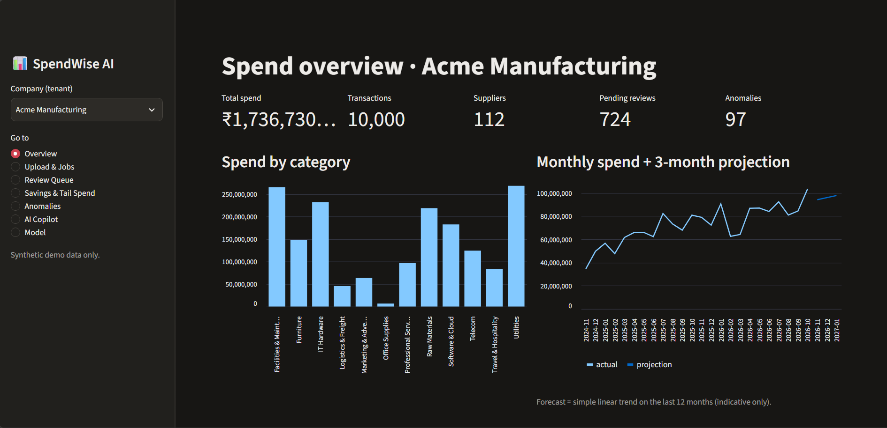
_Overview right after the first upload and supplier merges; the pending-review count (724) goes down as reviewers work through the queue._

---

## 🎯 The problem

Companies buy from hundreds of suppliers across many systems. The same supplier shows up as _"Alpha Technologies Pvt Ltd"_, _"ALPHA TECHNOLOGIES"_ and _"Alpha Technolgies Ltd"_, invoice descriptions are vague, and nobody can easily answer:
_Where is our money going? Are we paying different prices for the same item? Which invoices look wrong?_

SpendWise AI turns raw purchase CSVs into answers.

## ✨ Features

| Area                           | What it does                                                                                                                                                          |
| ------------------------------ | --------------------------------------------------------------------------------------------------------------------------------------------------------------------- |
| **Async ingestion**            | Upload a CSV, get a job ID instantly, a background worker does the heavy lifting; status is trackable.                                                                |
| **Idempotent uploads**         | The same file (SHA-256 per tenant) can never be imported twice.                                                                                                       |
| **Data cleaning**              | Validates columns, parses dates/numbers, rejects invalid rows, removes exact duplicates.                                                                              |
| **Supplier entity resolution** | Normalized-name matching + RapidFuzz similarity + email domain. High similarity auto-merges; borderline pairs go to a human review queue.                             |
| **AI spend classification**    | TF-IDF (word + character n-grams) + Logistic Regression with a **confidence score** for every prediction.                                                             |
| **Human-in-the-loop**          | Low-confidence items go to a review queue; corrections are stored as feedback and used to **retrain** a tenant-specific model.                                        |
| **Price variance**             | Finds items bought from several suppliers at different prices and estimates savings potential.                                                                        |
| **Tail spend**                 | Finds the long tail of small suppliers (bottom 20% of spend) and categories to consolidate.                                                                           |
| **Anomaly detection**          | Robust per-item z-score + Isolation Forest, with a readable reason for each flag. Vague descriptions ("Misc purchase") are excluded because they mix unrelated items. |
| **Trend + projection**         | Monthly spend history and a simple 3-month linear projection.                                                                                                         |
| **AI Copilot**                 | Natural-language questions answered through **validated, read-only analytics tools** (tool calling); the LLM never touches the database directly.                     |
| **Multi-tenancy & security**   | Tenant resolved from an API key, every query filtered by `tenant_id`, per-tenant rate limiting, audit logs.                                                           |
| **Caching**                    | Redis cache-aside for analytics with a per-tenant version counter (in-memory fallback without Redis).                                                                 |

## 🖼️ Screenshots

**Upload & processing jobs** — async job finished: 10,000 rows loaded, 0 rejected, 2.76 s.
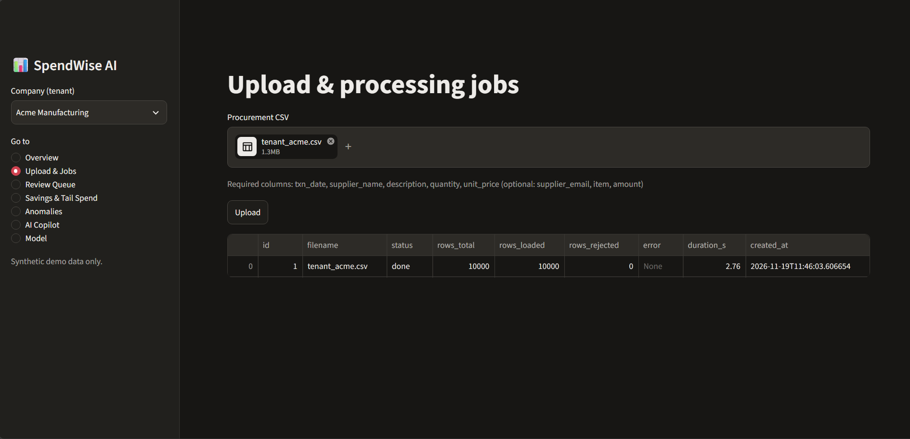

**Human-in-the-loop review** — lowest-confidence transactions first (672 still pending after 11 corrections); the reviewer confirms or corrects the category.
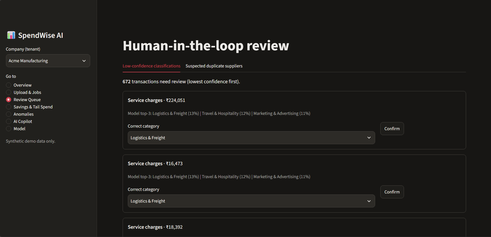

**Retraining from reviewer feedback** — a new tenant-specific model version (`acme-20261119123546`) is created from 11 corrections.
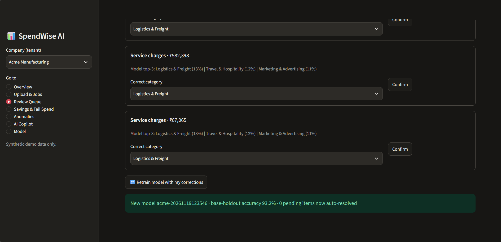

**Price variance & tail spend** — same item, different supplier prices, with an estimated savings potential.
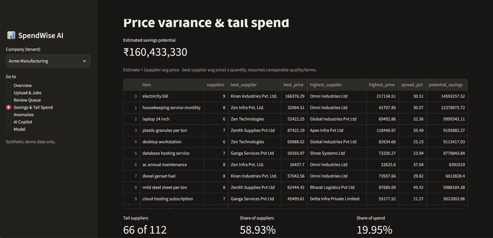
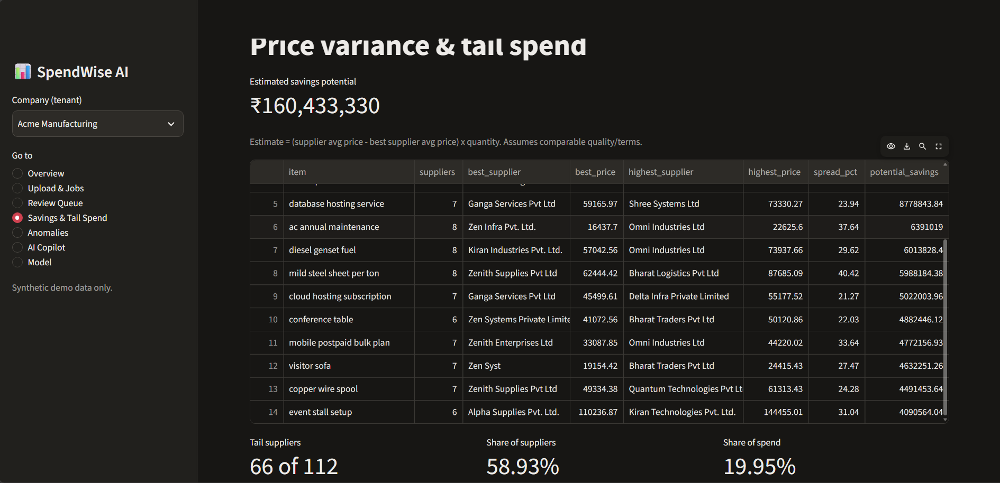

**Anomalies** — 97 flagged transactions for the demo tenant.
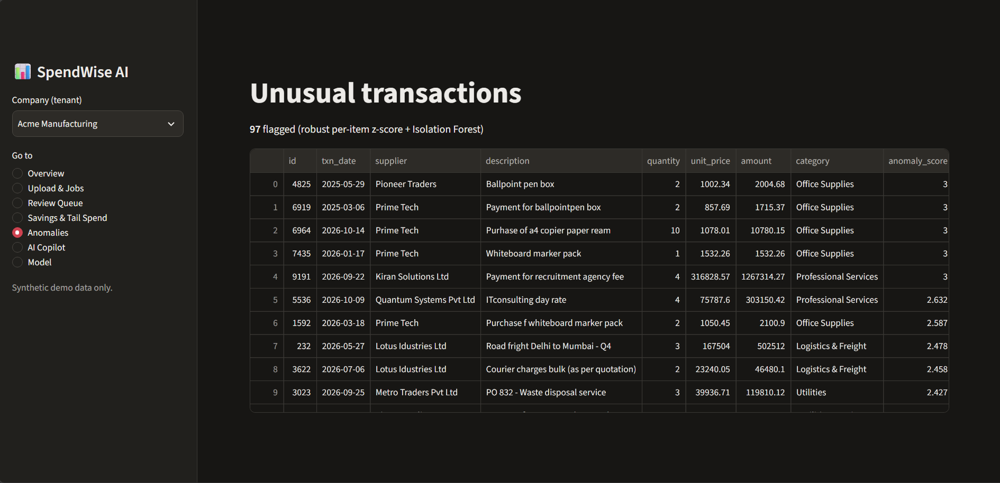

**Model versions** — base model metrics and the retrained tenant version (hold-out accuracy 93.19%, macro-F1 0.9336, 11 feedback rows).
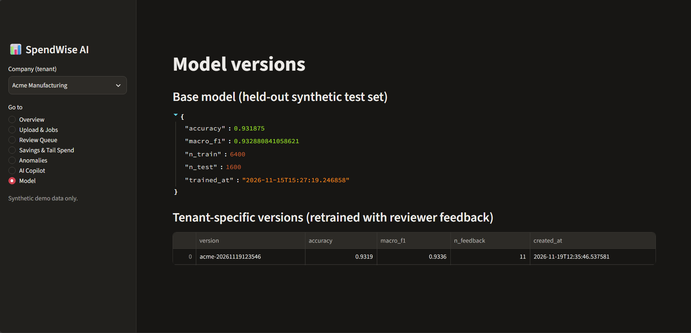

**Top suppliers** (after human-reviewed duplicate merging)
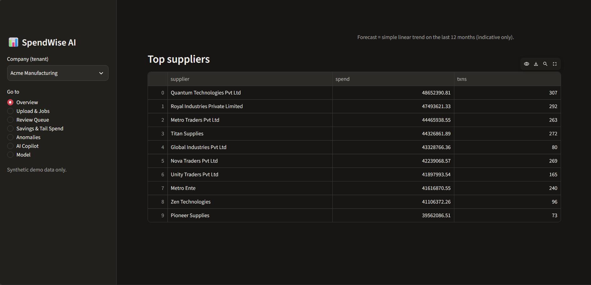

**AI Copilot** — the table and the total (160,433,330.42) come straight from the `savings_opportunities` tool; `mode: llm` and the tools used are shown under every answer. Note: the sentence saying these suppliers "account for the bulk" of the spreads is the LLM's own wording; the five listed items are about 34% of the total estimated savings.
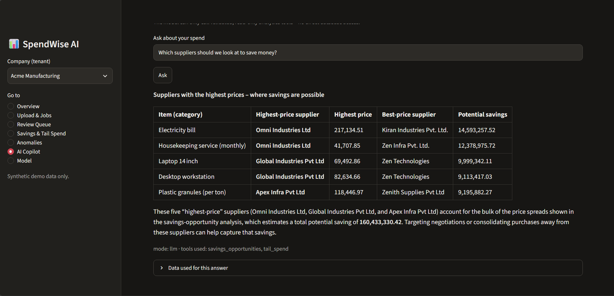

## 🏗️ Architecture

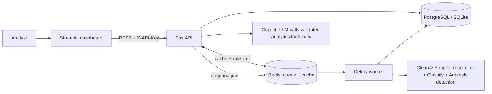

**Pipeline for every upload:** `CSV → validate & clean → supplier resolution → classification (+confidence) → review routing → anomaly detection → store → cache invalidation`

### Key design decisions

| Decision                                            | Why                                                                                            |
| --------------------------------------------------- | ---------------------------------------------------------------------------------------------- |
| Async ingestion (Celery + Redis)                    | A large CSV must not block an HTTP request; the user polls a job instead.                      |
| Idempotency (file hash + unique constraint)         | Retries or double clicks can't create duplicate data.                                          |
| `tenant_id` on every table, tenant from the API key | One company can never read another's data (covered by tests; cross-tenant access returns 404). |
| Cache-aside + version counter                       | Dashboards are read-heavy; any write bumps the version so stale cache is never served.         |
| Confidence threshold (0.60) + human review          | AI handles easy cases, humans decide uncertain ones, and their corrections feed retraining.    |
| Tool-calling copilot instead of text-to-SQL         | Answers come from computed results and the LLM has no direct database access.                  |
| Composite indexes on `(tenant_id, …)`               | Match the real query patterns.                                                                 |
| Redis/Celery optional locally                       | Runs on a laptop without Docker; Docker Compose runs the full stack.                           |

## 🧰 Tech stack

**Backend:** Python, FastAPI, SQLAlchemy · **Data/ML:** Pandas, NumPy, scikit-learn, RapidFuzz · **Storage:** PostgreSQL (SQLite for quick local runs) · **Queue/Cache:** Redis, Celery · **UI:** Streamlit · **AI:** any OpenAI-compatible API (tested with a free Groq key) · **Testing/Infra:** Pytest, Docker Compose

## 🚀 Quick start (no Docker, about 5 minutes)

```powershell
# from the project root (the folder that contains requirements.txt)
pip install -r requirements.txt
python scripts/generate_data.py          # creates synthetic CSVs in data/generated/
python scripts/bootstrap.py              # trains the base classifier
python -m uvicorn backend.app.main:app --port 8000      # terminal 1  (API docs: http://localhost:8000/docs)
python -m streamlit run dashboard/app.py                # terminal 2  (http://localhost:8501)
```

Then in the dashboard: choose a company → **Upload & Jobs** → upload `data/generated/tenant_acme.csv`.
Demo API keys (header `X-API-Key`): `demo-acme-key`, `demo-nova-key`, `demo-orbit-key`

**CSV format** — required: `txn_date, supplier_name, description, quantity, unit_price`; optional: `supplier_email, item, amount`.

### Full stack with Docker (PostgreSQL + Redis + Celery worker)

```bash
docker compose up --build        # dashboard http://localhost:8501 , API docs http://localhost:8000/docs
```

Starts PostgreSQL 16, Redis 7, the API, a Celery worker and the dashboard (health-checked start order). Check `http://localhost:8000/health`: it should report `"cache": "redis", "queue": "celery"`.

**Verification status (honest):** the same stack (PostgreSQL 16 + Redis + Celery with 2 workers) was tested end-to-end _outside_ containers; the container build/run itself (`Dockerfile`, `docker-compose.yml`) has not been executed yet, so check `docker compose logs <service>` if something fails.

### Copilot with a free LLM key

Create a file named `.env` in the project root (it is git-ignored, so the key is never uploaded):

```
LLM_API_KEY=your_key_here
```

It is loaded automatically for local runs and passed through by `docker compose`. (You can also set it per terminal with `$env:LLM_API_KEY="..."`.) Optional: `LLM_BASE_URL` / `LLM_MODEL` for other OpenAI-compatible providers; tested with a free Groq key. Without a key the copilot falls back to a rule-based router that calls the same tools. **Never commit API keys.**

## 🔌 API overview

| Method   | Endpoint                                                                  | Purpose                                    |
| -------- | ------------------------------------------------------------------------- | ------------------------------------------ |
| POST     | `/uploads`                                                                | Upload a CSV (returns job id, idempotent)  |
| GET      | `/uploads`, `/uploads/{id}`                                               | Job list / status                          |
| GET      | `/analytics/overview` · `categories` · `suppliers` · `trend`              | Spend summaries                            |
| GET      | `/analytics/price-variance` · `tail-spend` · `anomalies` · `transactions` | Savings, tail, anomalies, paginated rows   |
| GET/POST | `/review/classifications`                                                 | Low-confidence queue / submit a correction |
| POST     | `/review/retrain`                                                         | Retrain the tenant model with feedback     |
| GET/POST | `/review/suppliers`, `/review/suppliers/{id}/{approve\|reject}`           | Duplicate-supplier review                  |
| GET      | `/review/model`                                                           | Model versions and metrics                 |
| POST     | `/copilot`                                                                | Ask a question in natural language         |
| GET      | `/health`                                                                 | Cache / queue mode                         |

Interactive docs: `http://localhost:8000/docs`

## 📈 Measured results

Measured on my laptop (Windows, Python 3.12, SQLite, in-memory cache, single process) on **synthetic data** for the demo tenant "Acme Manufacturing" (10,000 rows):

| Metric                                                                      | Result                                                                                                                                                                                                   |
| --------------------------------------------------------------------------- | -------------------------------------------------------------------------------------------------------------------------------------------------------------------------------------------------------- |
| Classifier accuracy / macro-F1 (20% held-out set; 6,400 train / 1,600 test) | **93.2% / 0.933**                                                                                                                                                                                        |
| Transactions routed to human review (confidence < 0.60)                     | **~7%** (6.8%–7.5% across the three tenants)                                                                                                                                                             |
| End-to-end ingestion (clean → resolve → classify → anomaly → store)         | **10,000 rows in ~2.8 s** via the API job                                                                                                                                                                |
| Supplier resolution                                                         | 125 suppliers after automatic matching → **112 after 13 human-reviewed merges** (the generator created 112)                                                                                              |
| Anomalies flagged                                                           | **97** (~1% of rows)                                                                                                                                                                                     |
| Price-variance savings estimate                                             | **₹160.4 M** (≈9% of total spend; driven by the supplier price spread built into the synthetic data)                                                                                                     |
| Tail spend                                                                  | 66 of 112 suppliers (58.9%) account for 19.95% of spend                                                                                                                                                  |
| Retraining demo                                                             | 11 reviewer corrections → new model version, base hold-out accuracy 93.19% (macro-F1 0.9336); 0 pending items auto-resolved. Shows the feedback loop works end-to-end; it is not a claimed accuracy gain |
| Automated tests                                                             | **14 passing** (cleaning, name normalization, anomaly detection incl. vague-item exclusion, cache TTL handling, upload flow, idempotency, tenant isolation, review + retrain, copilot)                   |

Reproduce with `python -m pytest tests -q` and `python scripts/benchmark.py`.

### Full-stack validation (PostgreSQL 16 + Redis + Celery, build sandbox on Linux)

Run outside containers with 2 Celery workers, using the same code and settings as the Docker setup:

| Check                                               | Result                                                                                  |
| --------------------------------------------------- | --------------------------------------------------------------------------------------- |
| Two tenants uploading at once (10,000 + 8,000 rows) | both jobs `done`, processed in parallel in ~5.9 s wall time                             |
| Duplicate upload of the same file                   | detected, not re-processed                                                              |
| Tenant isolation                                    | other tenants see 0 rows; cross-tenant job lookup returns 404                           |
| Redis cache-aside (price-variance analytics)        | ~93 ms first call → ~5 ms cached                                                        |
| Rate limiting (120 requests / minute / tenant)      | requests above the limit get HTTP 429                                                   |
| Human review → retrain → supplier merge             | all succeeded                                                                           |
| Bug found only on real Redis/Postgres               | Redis rejects `SET … EX 0`; fixed (`ttl=0` now means "no expiry") and covered by a test |

## ⚠️ Honest limitations

- Data is synthetic and templated, so accuracy is **optimistic**: auto-accepted predictions are ~100% correct here only because the synthetic descriptions are easy. Real invoices will be noisier.
- Vague descriptions ("Misc purchase") get low confidence by design and always land in the review queue; the demo's correct answer for them is random label noise.
- Anomaly **precision/recall is not measured** (no labelled anomalies).
- Price-variance savings are an **estimate** that assumes comparable quality and terms.
- The Copilot explains tool results, but an LLM can occasionally add a claim the tool output does not state (I saw this during testing, e.g. "account for the bulk of the spreads" when the listed items were ~34% of total savings). The "Data used for this answer" panel shows the exact source data.
- The forecast is a simple linear trend, not a tuned time-series model.
- Not implemented: role-based access control, embeddings/RAG, public deployment.

## 🗺️ Roadmap

Detailed plan to production-style (CI, migrations, auth/RBAC, observability, load tests, ML rigor): [`docs/production-roadmap.md`](docs/production-roadmap.md)

- [ ] Embedding-based classification and supplier matching (compare against TF-IDF with measured metrics)
- [ ] RBAC (admin / analyst / viewer) and per-user audit trail
- [ ] RAG over procurement policy documents
- [ ] Proper time-series forecasting
- [ ] CI pipeline and public deployment

## 📁 Project structure

```
spendwise-ai/
├── backend/app/
│   ├── api/          uploads, analytics, review, copilot routes
│   ├── services/     cleaning, normalization, classification, anomaly, analytics, pipeline, copilot
│   ├── workers/      Celery app and tasks
│   ├── models.py     database schema (tenant_id on every business table)
│   ├── cache.py      Redis cache with in-memory fallback
│   ├── deps.py       API-key auth + rate limiting
│   └── main.py       FastAPI app
├── dashboard/app.py  Streamlit UI
├── scripts/          generate_data.py · bootstrap.py · benchmark.py
├── tests/            pytest suite
├── migrations/       Alembic schema migrations
├── docs/             architecture.md · production-roadmap.md · images/
├── docker-compose.yml · Dockerfile · requirements.txt
└── data/generated/   synthetic CSVs (created by generate_data.py)
```

## 🗄️ Database

`tenants` · `uploads` (unique tenant + file hash) · `suppliers` · `supplier_matches` · `transactions` (indexed on tenant + category / supplier / review status / date) · `feedback` · `model_versions` · `audit_logs`

The schema is versioned with Alembic (`migrations/`) and applied automatically on start-up. After changing `models.py`, run `python -m alembic revision --autogenerate -m "describe change"`; a test fails if models and migrations drift apart.

## 📄 License & data note

Educational portfolio project. All data is generated by `scripts/generate_data.py`. No proprietary or customer data is included.
