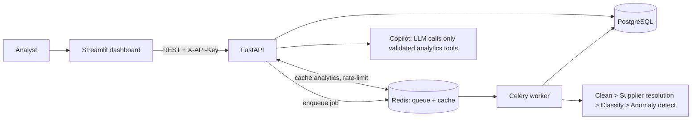

# Architecture

## Key design decisions (be ready to explain each)

| Decision                                                                    | Why                                                                                                    |
| --------------------------------------------------------------------------- | ------------------------------------------------------------------------------------------------------ |
| Async ingestion (Celery + Redis)                                            | A big CSV must not block an HTTP request; the user gets a job id and polls status.                     |
| Idempotent uploads (sha256 per tenant, unique constraint)                   | Retrying/double-clicking an upload can't import the same data twice.                                   |
| Multi-tenancy via `tenant_id` on every table; tenant comes from the API key | One tenant can never read another's rows; tested in `tests/test_api.py`.                               |
| Cache-aside analytics in Redis with a per-tenant version counter            | Dashboards are read-heavy; any upload/review bumps the version, which invalidates stale cache at once. |
| Human-in-the-loop for low-confidence classes + borderline supplier matches  | AI suggests, a human decides uncertain cases; corrections retrain the model.                           |
| Copilot uses tool-calling, never raw SQL                                    | LLM output can't touch the database directly, and answers are grounded in computed results.            |
| Rate limiting per tenant                                                    | Protects the API from abuse (HTTP 429).                                                                |
| Indexes on (tenant_id, category / supplier_id / review_status / txn_date)   | Matches the real query patterns.                                                                       |
| Retry with backoff on DB errors in the worker                               | Transient failures don't lose jobs.                                                                    |
| Redis/Celery optional locally (memory cache + background tasks)             | Runs on a laptop without Docker; Docker Compose runs the full production-like stack.                   |

## Not built (honest scope)

RBAC roles, RAG over policy documents, embeddings, Kubernetes/Kafka, public deployment. Listed as future work.
